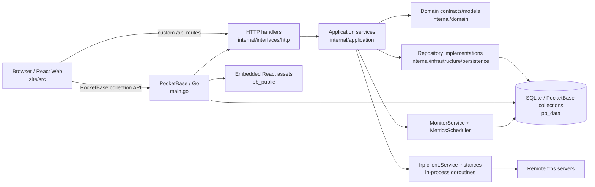
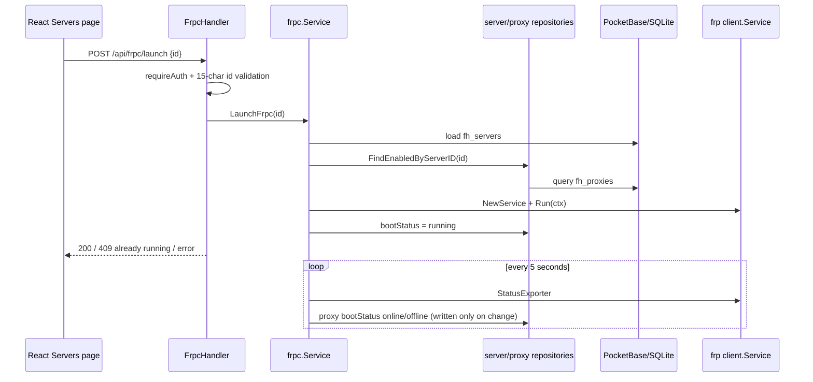

# System Architecture

## Verified Current State

Podux is a single Go/PocketBase service that hosts the API, SQLite persistence, background monitoring, frpc client services, and the React static site. [internal/application/frpc/service.go](../internal/application/frpc/service.go) keeps per-server `instance` entries, creates in-process `frp/client.Service` instances and runs them in goroutines; it does not launch separate `frpc` OS processes.

### Layers and Entry Points

- [main.go](../main.go) creates the PocketBase app, registers migrations, constructs repositories/services/handlers and calls each service's hook registration. The frpc lifecycle service owns configuration reconciliation and runtime projections; proxy hooks own conflict checks; server hooks own cascading cleanup. `OnTerminate` cancels/stops backup work (except its own restart), monitors, probes, metrics jobs, frps refreshes, frpc clients and notification workers before database shutdown. `OnServe` recovers restore status, resets runtime projections, starts background services, registers routes and configures the static-file fallback.
- `internal/domain` currently defines lightweight models, status values, and repository interfaces for servers, proxies, and visitors.
- `internal/application` handles statistics, imports, frpc configuration/lifecycle and export, proxy/visitor conflict checks, proxy expiry and batch changes, backups, networking and metrics (latency, frps dashboard stats, external probes), alerts (`notify`), system settings, and version queries.
- `internal/infrastructure/persistence` implements server, proxy, and visitor repositories with dbx/PocketBase.
- `internal/interfaces/http` exposes `/api/dashboard/*`, `/api/frpc/*`, `/api/import/*`, `/api/servers*`, `/api/system/*` (including `/api/system/backups*`), `/api/notifications*`, `/api/proxies/*`, `/api/api-keys*`, `/api/metrics`, and `/api/frp/version`. PocketBase owns `/api/backups` (superuser only), so Podux's backup API lives under `/api/system/backups`: list, create, download, upload (body limit 2 GB), delete, `POST .../{name}/restore` (answers 202, then PocketBase replaces the data directory, runs the terminate hooks and re-executes the process) and `PUT .../schedule` (PocketBase's `backups.cron`/`cronMaxKeep`). `POST /api/proxies/batch` enables, disables, deletes or moves proxies in one transaction and reports the failing proxy with the conflict code/params. `GET /api/proxies/status[?serverId=]` combines frps dashboard traffic and external probe results per proxy, and returns each server's frps `subdomainHost` (from its dashboard) so the lists show `<subdomain>.<subdomainHost>`; `GET /api/proxies/{id}/traffic` returns frps's 7-day history (newest first); `GET /api/servers/{id}/frps` and `POST /api/servers/frps-test` read or test a dashboard. `/api/frpc/logs/stream` and `GET /api/frpc/logs/download` accept `id=all` for the whole log with server names in place of tags. `GET /api/frpc/export?id=&secrets=1` returns the server's persisted desired configuration as `frpc.toml` ([export.go](../internal/application/frpc/export.go)): the same generated proxies/visitors with their `<name>-<id>` names, secrets replaced with `<redacted>` unless `secrets=1`, TLS contents referenced as `certs/*.pem`, and empty/zero values dropped; tests load the result with frp's strict loader and validator. `GET/PUT /api/notifications` read and save `fh_settings.notifications`; `POST /api/notifications/test` sends a test message with the posted (unsaved) settings and returns a result per channel. `PUT /api/system/settings` merges the posted `general` keys into the stored ones. `/api/frpc/logs/stream` lifts PocketBase's 5-minute write timeout for the connection and answers 404 when no log file exists yet; otherwise it replays up to 50 lines, sends an `event: replay-end` frame, and then streams live lines. `GET/POST /api/api-keys` and `DELETE /api/api-keys/{id}` manage API keys (the token is only in the create response). `GET /api/metrics` writes the Prometheus text format from [exporter.go](../internal/application/monitoring/exporter.go): frpc status, latency and reachability probes, and cached frps dashboard stats, all as gauges, buffered so a failed query answers 500. API keys (`Authorization: Bearer pdx_...`) are resolved by the router middleware `APIKeyAuth`, which runs right after PocketBase's auth token loader and stores the key on the request without setting `e.Auth`; only routes wrapped with `requireScope` accept them: `read` for `/api/metrics`, `/api/dashboard/stats` and `/api/proxies/status`, `write` for `/api/frpc/launch|terminate|reload` and `/api/proxies/batch` (a read key gets 403). Everywhere else, including the PocketBase collection API, a key is a guest, so it cannot read secrets or manage keys. Except for initialization-status/initialization and the capability-protected restore-status endpoint described below, registered custom routes use `requireAuth`, which only accepts the `Authorization` header (the log stream no longer takes a `?token=` query parameter; the frontend reads it with `fetch`). `/api/servers` list items omit `auth`, `transport`, `log`, and `metadatas`; edit forms load full records through the PocketBase SDK. Its `search` is matched literally (LIKE wildcards escaped) by one expression shared by the count and the page; PocketBase's `~` filter is not used because it treats a value containing `%` as a raw pattern. [handlers_test.go](../internal/interfaces/http/handlers_test.go) drives every custom route through PocketBase's router to check authentication, one-time initialization, credential omission, search/paging, and ID validation.
- React also uses the PocketBase SDK directly for `fh_users`, `fh_servers`, `fh_proxies`, and `fh_visitors`; collection API rules control that access boundary. Conflict errors from [conflicts.go](../internal/application/proxy/conflicts.go) arrive as PocketBase field errors with codes `validation_port_conflict`, `validation_domain_conflict`, or `validation_bind_conflict` and a `name` param; `site/src/lib/fieldErrors.ts` translates them.

### Typical Request Flow

Standard server/proxy CRUD primarily uses the PocketBase SDK. Server lists, dashboard data, imports, settings, and runtime controls use custom APIs. The lifecycle service's `RegisterHooks` owns committed configuration reconciliation and protects `bootStatus` at collection request boundaries; clients cannot set actual runtime state. Its repository writes update only status columns, while request/import updates omit unchanged fields so old configuration snapshots cannot overwrite newer runtime projections. After a successful `fh_proxies` or `fh_visitors` create, update, or delete, a hook calls `RequestReload` for each affected running server (both the old and new server when a record moves), which runs `ReconcileServer` 300 ms after the last request, so a batch change reloads each server once; the frontend does not call `/api/frpc/reload` itself. `ReloadFrpc` pushes the configs through frp's `UpdateConfigSource`, which completes and filters them like startup does, so only proxies whose effective config changed are restarted; reloads of one server are serialized. Startup always reconciles again after publishing the initial client, including edits whose reload timer fired before that client existed, so a disable/delete between config snapshot and startup is not lost. Common config changes require lifecycle-managed full restart (hot reload remains for proxies/visitors); manual stop or shutdown takes precedence. Invalid common edits stop the old instance and leave an explicit error instead of silently running stale credentials.

[internal/frpconfig](../internal/frpconfig) centralizes stored common configuration mapping, native defaults and structural secret handling for importer/runtime/export. Native token authentication defaults are applied even when only `auth.token` is present. Overwriting imports replace native optional fields (including clearing an absent plugin/fallback) without resetting Podux runtime state, notes or auto-connect settings. Visitors pointing at private proxies actually imported in the same transaction are mapped to their generated runtime names; external-user targets are left unchanged.

Proxy configs are built from records with frp's `NewProxyConfigurerByType` (tcp, udp, http, https, stcp, sudp, xtcp, tcpmux), merging the keys of `fh_proxies.options` allowed for the type and visitors with `NewVisitorConfigurerByType` (stcp, sudp, xtcp); both go into the client's config source at launch and through `UpdateConfigSource` on reload. Visitors bind on the Podux host, default `bindAddr` 127.0.0.1; an xtcp visitor's `fallbackTo` (a visitor ID) becomes that visitor's runtime name. Certificates pasted into https2http/https2https/tls2raw plugins are written atomically (0600) beneath `<data>/frpc/<server>/plugin-certs/`, using verified proxy record IDs and content hashes, never editable names. `os.Root` confines writes and rejects symlink directory components. Content changes produce different config paths so frp rebuilds the TLS plugin; cleanup keeps the current and previous managed generation, without deleting user-supplied external paths. Export names use `certs/<proxy-id>.crt|key`.

[frpc.Service](../internal/application/frpc/service.go) keeps one instance per server. `LaunchFrpc` reserves the slot before building the config, so a second launch returns `ErrAlreadyRunning` (HTTP 409). `TerminateFrpc` waits up to 10 seconds for the client to exit; called while the instance is still building its config, it flags the instance and `LaunchFrpc` gives up with `ErrLaunchCancelled` (HTTP 409) instead of running, so a server deleted during (auto-)start leaves no frpc behind. An exiting instance only clears the map entry and statuses it still owns, so a quick stop/start cannot mark the new instance stopped.

frp logs through one package-level logger, so all servers share `<data dir>/frpc/frpc.log` (the PocketBase data dir: `--dir`, default `pb_data`). Each server's run context carries an xlog prefix `[podux:<id>]`; [logs.go](../internal/application/frpc/logs.go) filters the stream to that server and to its configured log level. The shared logger uses the most verbose level any launched server has requested: `log.Logger` is assigned once (before any frpc runs) at trace level, and an output filter with an atomic threshold drops lower lines, so lowering the level never swaps the logger under running clients. frp lines without a server context (a handful of global messages) are not shown in any server's log view.

### Startup Flow and Background Tasks

1. Go `init` loads `migrations`; `main` registers the migrate command and wires dependencies.
2. PocketBase `serve` triggers `OnServe`, which sets every server to `stopped` and every proxy to `offline`.
3. After a 10-second delay, servers with `autoConnection=true` start automatically.
4. `MonitorService` immediately runs TCP latency and missing-geolocation checks, then repeats them at intervals from `fh_settings.general`; defaults are 30 seconds (clamped to 10–300 seconds) and 24 hours. Server traversal uses 128-record keyset pages, not a 500-record cap. Latency uses 16 workers, cancellable dialing and a 64-sample/one-second batched writer; `Stop` cancels and waits. Saving settings resets intervals without restarting. Latest results, including failures, live in memory; only successful latencies go to `fh_metrics_raw`. Cache misses fall back to the last 10 minutes of stored history once; endpoint changes invalidate cache and advance a persisted fallback lower bound. Warm status/dashboard requests perform no historical scan. Geolocation requests share a process-wide serial public-API gate with at least `1min/45 + 1ms` between starts; cache bounds are 4096 IPs, 24 hours for success and one minute for errors.
5. `MetricsScheduler.Register` starts background catch-up and the hourly/daily cron jobs. Startup and hourly jobs recover all completed UTC hourly/daily buckets since their persisted watermarks. Each bucket uses bulk SQL upsert and advances its watermark in the same transaction; indexed seeks skip empty periods. At 01:05 retention first catches up both rollups, then deletes raw data older than 7 days, hourly data older than 30 days and daily data older than one calendar year, in batches of at most 2000 rows. Failures stop watermark advancement and source cleanup. `Stop` cancels/waits before database shutdown.
6. [notify.Service](../internal/application/notify/service.go) observes every latency probe (via `MonitorService.SetLatencyObserver`) and every 5-second proxy status check and frpc exit (via `frpc.Service.SetObserver`). For running servers it alerts after 3 consecutive failed probes, 3 probes over the latency threshold, or an enabled proxy offline for 3 checks (grouped per server), and when frpc exits without the user stopping it; each alert is sent once and followed by one recovery message. Messages use `general.defaultLanguage` and are sent in the background to the enabled channels (webhook in generic/WeCom/DingTalk/Feishu format, Telegram, Bark, PocketBase SMTP email). State lives in memory and is cleared when a server is stopped or deleted.
7. A per-minute PocketBase cron job (`poduxProxyExpiry`, also run once at serve) disables enabled proxies whose `expiresAt` passed and sends a "proxy expired" alert.
8. [ProbeService](../internal/application/monitoring/probe.go) probes, from the Podux host, the online tcp (TCP connect to `serverAddr:remotePort`), http (GET with the proxy's Host on frps's vhost HTTP port, first location as path; frps's own 404 page or 502/503/504 count as failures) and https (TLS handshake with SNI) proxies of running servers. Ports and subdomain host come from the frps dashboard when configured (else 80/443). The target cycle is 1 minute. Within each `ProbeAll` round, an eight-worker server pool and a global limit of 16 in-flight probes bound resource use, with starts staggered and rate-limited separately for each server record: at most 4 concurrent probes and a minimum start interval of `max(250ms, 1min / N)` (`N` is that server's target count for the current round). `ProbeAll` waits for all servers to finish before the next round can start, so many or slow targets can delay that start; servers do not have independent recurring loops. Rounds never overlap and missed rounds are not replayed to catch up. This spreads short-lived connection bursts but does not guarantee elimination of FRP connection-pool-full errors. Each completed probe immediately updates its in-memory reachability result; only a complete server round is submitted to the alert observer. Notify alerts when a proxy fails in 3 consecutive complete rounds (usually about 3 minutes, longer with many or slow targets). `ProbeService.Stop` cancels queued and in-flight probes and waits for them to exit; stop-induced cancellations are not recorded as failures, incomplete rounds are not submitted to the observer, and cancellation does not trigger alerts. [FrpsService](../internal/application/monitoring/frps.go) collects `/api/serverinfo` and `/api/proxy/{type}` in a four-worker pool with a 128-item queue, coalescing per-server refreshes. Refresh cadence is 15 seconds, with a 20-second total deadline and 8-second individual HTTP timeout. UI stats, status and Prometheus reads return snapshots without waiting for remote I/O; a failed refresh preserves the previous successful data with `error`, `fetched`, `lastAttempt` and `refreshState` (`idle/queued/refreshing/stopped`). Credential/config changes and deletion cancel/invalidate old work. A cold probe waits for a configured dashboard's actual ports in its worker (at most 25 seconds) rather than incorrectly probing default ports. `/api/traffic/{name}` and dashboard connection tests remain explicit live requests. Names map as `<user>.<name>-<id>`; Stop cancels and waits.
   - Per-proxy opt-out is stored as `fh_proxies.probeDisabled` (false by default). [Probe hooks](../internal/application/monitoring/probe_hooks.go) invalidate queued/current-round results, cancel any in-flight probe and call `notify.Service.ForgetProbe` on opt-out, re-enable, move, disable or deletion. Completed-batch dispatch is serialized with invalidation so a late result or fast off/on toggle cannot recreate cleared alert state; other proxies and frpc offline alerts are unaffected. New rounds exclude opted-out proxies; re-enabled ones start fresh next round. Cached results disappear from `/api/proxies/status`, and the [exporter](../internal/application/monitoring/exporter.go) omits their `podux_proxy_reachable` sample, but keeps tunnel status and traffic. The field is stripped from frpc config/export; [ProxyNeedsReload](../internal/application/frpc/proxy_changes.go) prevents a probe-only edit from reloading frpc. Empty `healthCheck` is unrelated to this independent Podux probe.
9. After handlers are registered, `pb_public` is served through `embed.FS` with an SPA fallback; `/_/` remains the PocketBase Admin UI.

### Frontend Build and Embedding

The Vite development server listens on `0.0.0.0` and proxies `/api` to `127.0.0.1:8090`. Production builds do not automatically copy files to `pb_public`; CI performs that step through artifact downloads, while `build/build.sh` copies them explicitly. Go compilation still requires the directory to exist when `pb_public/index.html` is missing, and runtime logs a warning.

## Configuration, Persistence, and Deployment Boundaries

- PocketBase uses `pb_data/` as its default data root; the Docker volume mounts `/app/pb_data`. The database, uploads, the shared `pb_data/frpc/frpc.log`, and `pb_data/frpc/<id>/certs` are runtime data; the frpc paths follow `--dir` when it is set. Older versions wrote per-server logs to `pb_data/frpc/<id>/logs`; those files are no longer read.
- Server connection/authentication/transport/logging/metadata settings are stored in collection JSON fields. TLS certificate contents are written to a server-specific certificates directory at startup, with private-key permissions set to `0600`. Never commit this content.
- The fixed system-settings record ID is `wcstsqmz8hur331`; the initialization transaction checks the initialized flag **inside** the serialized write transaction and creates both the first `fh_users` record and settings. Only a missing row counts as uninitialized, not a database error. General-settings read/merge/save also uses one transaction to preserve concurrent patches.
- Geolocation and version queries access external services and depend on network availability. frpc instance status exists only in memory; database statuses are reset together on restart.
- The Dockerfile builds React and then compiles a static Go binary; `deploy/docker-compose.yml` uses host networking and a `./data` bind mount owned by UID 1000, matching the install docs; `deploy/docker-compose.build.yml` builds from the checkout with a named volume. This document makes no claims about production reverse proxies, backups, or high availability that are not verified in repository configuration.

## CI and Quality Boundaries

`.github/workflows/ci.yml` runs on pushes to main/dev and pull requests to main. It performs a frozen frontend install, lint, Vitest tests, and a production build (whose `tsc -b` is the type check); it then downloads the frontend artifact and runs `go vet`, `go test -race`, and a Linux amd64 build. A separate docs job builds the VitePress site, which fails on dead links. An e2e job builds Podux and runs [test/e2e/run.sh](../test/e2e/run.sh) against the official frps release matching the embedded frp: tunnels of every type, plugins, conflicts, batch changes, dashboard traffic, probes, export, logs, expiry, backup/restore with the restart, and webhook alerts. Pushes to dev also build and publish a multi-architecture container. `.github/workflows/docs.yml` deploys `docs/` to GitHub Pages (`https://derrors.github.io/podux/`, VitePress `base: '/podux/'`) on pushes to main that touch `docs/`; theme components must wrap public asset paths with `withBase`. `.github/workflows/release.yml` publishes binaries and images for `v*` tags, using the annotated tag message as the release notes.

## Runtime and Write Ownership

Podux remains a modular monolith. Application services own write invariants; PocketBase record hooks enforce the same boundary for collection SDK writes, imports and batch APIs. Read-only query projections may query PocketBase directly instead of adding pass-through domain/repository wrappers. SQLite's single nonconcurrent write connection is the serialization boundary, not a second application-wide mutex. Hooks must use `e.App` inside a transaction; external side effects and lifecycle work belong after successful commit. No microservice or independent worker deployment is introduced.

## Backup Restore Contract

[backup/restore.go](../internal/application/backup/restore.go) owns restore jobs rather than the HTTP handler. An authenticated `POST /api/system/backups/{name}/restore` returns 202 with `{id,state,startedAt,updatedAt}`. States are `queued`, `running`, `restarting`, `succeeded`, `failed`. Only one job runs at a time; competing restore/create/delete/upload operations are rejected rather than racing data replacement. ZIP uploads validate entry paths and a SQLite `data.db` header before storage; PocketBase still extracts and checks the full archive before replacing data.

`GET /api/system/backups/restore-status` is a narrowly scoped exception to login authentication: it requires the job's 256-bit random ID in `X-Podux-Restore-ID`, not in a URL, and only discloses that job's status and a fixed error code. This permits polling when the restored database invalidates the old login. Unknown/expired capabilities return 404; responses use `Cache-Control: no-store`. The UI holds the capability in memory, cancels polling on unmount, limits each request to 5 seconds and the overall wait to 30 minutes. A timeout is not success or proof of cancellation.

The service atomically persists the latest job as `backups/.podux-restore.json` (0600). PocketBase excludes the local backups directory from backup creation and restore even with S3 storage. An app wrapper records `restarting` only when PocketBase calls `Restart` **after replacing data**; a returning/failed restart is marked failed. After successful bootstrap, `RecoverRestore` confirms this checkpoint as succeeded; interrupted queued/running jobs become failed. A plain health check or unrelated process restart never promotes a running job. The task ID is not logged. Normal shutdown cancels/waits for restore work; its own restart hook must not wait on that same goroutine. PocketBase's local ZIP extraction is synchronous and does not provide a hard cancellation deadline; cancellation and the UI timeout must not be described as forcibly interrupting that stage.

## Availability Boundaries

API, SQLite, monitoring and frpc clients share one process and one data directory. Upgrades, restart and restore interrupt tunnels. Do not run multiple Podux processes against one writable data directory. High availability would require a separate design for distributed ownership, worker isolation and persistence; it is not implemented by this hardening work.

Notifications are best effort, not a durable event log. [notify/service.go](../internal/application/notify/service.go) uses two delivery workers and a 256-message bounded queue; overload drops messages with a warning rather than spawning unlimited goroutines or blocking tunnel work. HTTP sends cancel on shutdown. PocketBase's SMTP interface has no cancellation API, so shutdown waits at most 15 seconds for delivery; stuck SMTP work remains bounded by the two workers.
