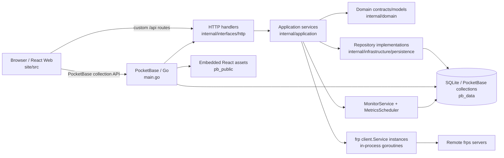
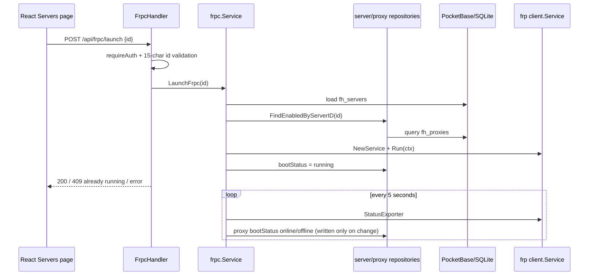
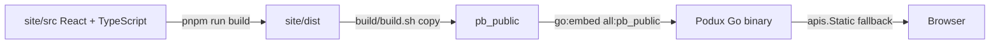

# System Architecture

## Verified Current State

Podux is a single Go/PocketBase service that hosts the API, SQLite persistence, background monitoring, frpc client services, and the React static site. The code calls running instances `processes`, but `internal/application/frpc/service.go` actually creates in-process `frp/client.Service` instances and runs them in goroutines; it does not launch separate `frpc` OS processes.

### Layers and Entry Points

- `main.go` creates the PocketBase app, registers migration commands, constructs repositories/services/handlers, binds the `fh_proxies` and `fh_visitors` create/update/delete hooks (reload the affected running frpc), the conflict checks on saving them, the `fh_servers` delete hooks (cascade cleanup, see the database design), and the `OnTerminate` hook that stops `MonitorService` and frpc clients, and initializes state, starts background tasks, registers routes, and configures the static-file fallback in `OnServe`.
- `internal/domain` currently defines lightweight models, status values, and repository interfaces for servers, proxies, and visitors.
- `internal/application` handles statistics, imports, frpc configuration/lifecycle and export, proxy/visitor conflict checks, proxy expiry and batch changes, backups, networking and metrics (latency, frps dashboard stats, external probes), alerts (`notify`), system settings, and version queries.
- `internal/infrastructure/persistence` implements server, proxy, and visitor repositories with dbx/PocketBase.
- `internal/interfaces/http` exposes `/api/dashboard/*`, `/api/frpc/*`, `/api/import/*`, `/api/servers*`, `/api/system/*` (including `/api/system/backups*`), `/api/notifications*`, `/api/proxies/*`, `/api/api-keys*`, `/api/metrics`, and `/api/frp/version`. PocketBase owns `/api/backups` (superuser only), so Podux's backup API lives under `/api/system/backups`: list, create, download, upload (body limit 2 GB), delete, `POST .../{name}/restore` (answers 202, then PocketBase replaces the data directory, runs the terminate hooks and re-executes the process) and `PUT .../schedule` (PocketBase's `backups.cron`/`cronMaxKeep`). `POST /api/proxies/batch` enables, disables, deletes or moves proxies in one transaction and reports the failing proxy with the conflict code/params. `GET /api/proxies/status[?serverId=]` combines frps dashboard traffic and external probe results per proxy; `GET /api/proxies/{id}/traffic` returns frps's 7-day history (newest first); `GET /api/servers/{id}/frps` and `POST /api/servers/frps-test` read or test a dashboard. `/api/frpc/logs/stream` and `GET /api/frpc/logs/download` accept `id=all` for the whole log with server names in place of tags. `GET /api/frpc/export?id=&secrets=1` returns the server's running configuration as `frpc.toml` ([export.go](../internal/application/frpc/export.go)): the same generated proxies/visitors with their `<name>-<id>` names, secrets replaced with `<redacted>` unless `secrets=1`, TLS contents referenced as `certs/*.pem`, and empty/zero values dropped; tests load the result with frp's strict loader and validator. `GET/PUT /api/notifications` read and save `fh_settings.notifications`; `POST /api/notifications/test` sends a test message with the posted (unsaved) settings and returns a result per channel. `PUT /api/system/settings` merges the posted `general` keys into the stored ones. `/api/frpc/logs/stream` lifts PocketBase's 5-minute write timeout for the connection and answers 404 when no log file exists yet; otherwise it replays up to 50 lines, sends an `event: replay-end` frame, and then streams live lines. `GET/POST /api/api-keys` and `DELETE /api/api-keys/{id}` manage API keys (the token is only in the create response). `GET /api/metrics` writes the Prometheus text format from [exporter.go](../internal/application/monitoring/exporter.go): frpc status, latency and reachability probes, and cached frps dashboard stats, all as gauges, buffered so a failed query answers 500. API keys (`Authorization: Bearer pdx_...`) are resolved by the router middleware `APIKeyAuth`, which runs right after PocketBase's auth token loader and stores the key on the request without setting `e.Auth`; only routes wrapped with `requireScope` accept them: `read` for `/api/metrics`, `/api/dashboard/stats` and `/api/proxies/status`, `write` for `/api/frpc/launch|terminate|reload` and `/api/proxies/batch` (a read key gets 403). Everywhere else, including the PocketBase collection API, a key is a guest, so it cannot read secrets or manage keys. Except for initialization-status and initialization endpoints, registered custom routes use `requireAuth`, which only accepts the `Authorization` header (the log stream no longer takes a `?token=` query parameter; the frontend reads it with `fetch`). `/api/servers` list items omit `auth`, `transport`, `log`, and `metadatas`; edit forms load full records through the PocketBase SDK. Its `search` is matched literally (LIKE wildcards escaped) by one expression shared by the count and the page; PocketBase's `~` filter is not used because it treats a value containing `%` as a raw pattern. [handlers_test.go](../internal/interfaces/http/handlers_test.go) drives every custom route through PocketBase's router to check authentication, one-time initialization, credential omission, search/paging, and ID validation.
- React also uses the PocketBase SDK directly for `fh_users`, `fh_servers`, `fh_proxies`, and `fh_visitors`; collection API rules control that access boundary. Conflict errors from [conflicts.go](../internal/application/proxy/conflicts.go) arrive as PocketBase field errors with codes `validation_port_conflict`, `validation_domain_conflict`, or `validation_bind_conflict` and a `name` param; `site/src/lib/fieldErrors.ts` translates them.

### Typical Request Flow

Standard server/proxy CRUD primarily uses the PocketBase SDK. Server lists, dashboard data, imports, settings, and runtime controls use custom APIs. After a successful `fh_proxies` or `fh_visitors` create, update, or delete, a hook calls `RequestReload` for each affected running server (both the old and new server when a record moves), which runs `ReloadFrpc` 300 ms after the last request, so a batch change reloads each server once; the frontend does not call `/api/frpc/reload` itself. `ReloadFrpc` pushes the configs through frp's `UpdateConfigSource`, which completes and filters them like startup does, so only proxies whose effective config changed are restarted; reloads of one server are serialized.

Proxy configs are built from records with frp's `NewProxyConfigurerByType` (tcp, udp, http, https, stcp, sudp, xtcp, tcpmux), merging the keys of `fh_proxies.options` allowed for the type and visitors with `NewVisitorConfigurerByType` (stcp, sudp, xtcp); both go into the client's config source at launch and through `UpdateConfigSource` on reload. Visitors bind on the Podux host, default `bindAddr` 127.0.0.1; an xtcp visitor's `fallbackTo` (a visitor ID) becomes that visitor's runtime name. Certificates pasted into https2http/https2https/tls2raw plugins are written to `<data>/frpc/<server>/plugin-certs/` before launch and reload.

[frpc.Service](../internal/application/frpc/service.go) keeps one instance per server. `LaunchFrpc` reserves the slot before building the config, so a second launch returns `ErrAlreadyRunning` (HTTP 409). `TerminateFrpc` waits up to 10 seconds for the client to exit; called while the instance is still building its config, it flags the instance and `LaunchFrpc` gives up with `ErrLaunchCancelled` (HTTP 409) instead of running, so a server deleted during (auto-)start leaves no frpc behind. An exiting instance only clears the map entry and statuses it still owns, so a quick stop/start cannot mark the new instance stopped.

frp logs through one package-level logger, so all servers share `<data dir>/frpc/frpc.log` (the PocketBase data dir: `--dir`, default `pb_data`). Each server's run context carries an xlog prefix `[podux:<id>]`; [logs.go](../internal/application/frpc/logs.go) filters the stream to that server and to its configured log level. The shared logger uses the most verbose level any launched server has requested: `log.Logger` is assigned once (before any frpc runs) at trace level, and an output filter with an atomic threshold drops lower lines, so lowering the level never swaps the logger under running clients. frp lines without a server context (a handful of global messages) are not shown in any server's log view.

### Startup Flow and Background Tasks

1. Go `init` loads `migrations`; `main` registers the migrate command and wires dependencies.
2. PocketBase `serve` triggers `OnServe`, which sets every server to `stopped` and every proxy to `offline`.
3. After a 10-second delay, servers with `autoConnection=true` start automatically.
4. `MonitorService` immediately runs TCP latency and missing-geolocation checks, then repeats them at intervals from `fh_settings.general`; server-side defaults are 30 seconds (clamped to 10–300 seconds, matching the settings page) and 24 hours. Saving settings applies new intervals to the running tickers without a restart. The latest probe result per server, including failures, is held in memory by `MetricsService`; only successful latencies are written to `fh_metrics_raw`. Before a server's first probe after startup, its latest stored value from the last 10 minutes is used.
5. PocketBase cron aggregates raw metrics into hourly metrics at minute 5 of every hour. At 01:05 each day it aggregates daily metrics and deletes raw data older than 7 days, hourly data older than 30 days, and daily data older than one year. The dashboard's max latency comes from `MetricsService`'s in-memory latest status rather than a scan of `fh_metrics_raw`.
6. [notify.Service](../internal/application/notify/service.go) observes every latency probe (via `MonitorService.SetLatencyObserver`) and every 5-second proxy status check and frpc exit (via `frpc.Service.SetObserver`). For running servers it alerts after 3 consecutive failed probes, 3 probes over the latency threshold, or an enabled proxy offline for 3 checks (grouped per server), and when frpc exits without the user stopping it; each alert is sent once and followed by one recovery message. Messages use `general.defaultLanguage` and are sent in the background to the enabled channels (webhook in generic/WeCom/DingTalk/Feishu format, Telegram, Bark, PocketBase SMTP email). State lives in memory and is cleared when a server is stopped or deleted.
7. A per-minute PocketBase cron job (`poduxProxyExpiry`, also run once at serve) disables enabled proxies whose `expiresAt` passed and sends a "proxy expired" alert.
8. [ProbeService](../internal/application/monitoring/probe.go) probes every minute, from the Podux host, the online tcp (TCP connect to `serverAddr:remotePort`), http (GET with the proxy's Host on frps's vhost HTTP port, first location as path; frps's own 404 page or 502/503/504 count as failures) and https (TLS handshake with SNI) proxies of running servers. Ports and subdomain host come from the frps dashboard when configured (else 80/443). Results stay in memory; notify alerts after 3 failed rounds. [FrpsService](../internal/application/monitoring/frps.go) reads `/api/serverinfo`, `/api/proxy/{type}` and `/api/traffic/{name}` from the dashboard (Basic auth), caches a server's stats for 15 seconds and matches frps names `<user>.<name>-<id>`.
9. After handlers are registered, `pb_public` is served through `embed.FS` with an SPA fallback; `/_/` remains the PocketBase Admin UI.

### Frontend Build and Embedding

The Vite development server listens on `0.0.0.0` and proxies `/api` to `127.0.0.1:8090`. Production builds do not automatically copy files to `pb_public`; CI performs that step through artifact downloads, while `build/build.sh` copies them explicitly. Go compilation still requires the directory to exist when `pb_public/index.html` is missing, and runtime logs a warning.

## Configuration, Persistence, and Deployment Boundaries

- PocketBase uses `pb_data/` as its default data root; the Docker volume mounts `/app/pb_data`. The database, uploads, the shared `pb_data/frpc/frpc.log`, and `pb_data/frpc/<id>/certs` are runtime data; the frpc paths follow `--dir` when it is set. Older versions wrote per-server logs to `pb_data/frpc/<id>/logs`; those files are no longer read.
- Server connection/authentication/transport/logging/metadata settings are stored in collection JSON fields. TLS certificate contents are written to a server-specific certificates directory at startup, with private-key permissions set to `0600`. Never commit this content.
- The fixed system-settings record ID is `wcstsqmz8hur331`; the initialization transaction creates both the first `fh_users` record and the settings record.
- Geolocation and version queries access external services and depend on network availability. frpc instance status exists only in memory; database statuses are reset together on restart.
- The Dockerfile builds React and then compiles a static Go binary; `deploy/docker-compose.yml` uses host networking and a `./data` bind mount owned by UID 1000, matching the install docs; `deploy/docker-compose.build.yml` builds from the checkout with a named volume. This document makes no claims about production reverse proxies, backups, or high availability that are not verified in repository configuration.

## CI and Quality Boundaries

`.github/workflows/ci.yml` runs on pushes to main/dev and pull requests to main. It performs a frozen frontend install, lint, Vitest tests, and a production build (whose `tsc -b` is the type check); it then downloads the frontend artifact and runs `go vet`, `go test -race`, and a Linux amd64 build. A separate docs job builds the VitePress site, which fails on dead links. An e2e job builds Podux and runs [test/e2e/run.sh](../test/e2e/run.sh) against the official frps release matching the embedded frp: tunnels of every type, plugins, conflicts, batch changes, dashboard traffic, probes, export, logs, expiry, backup/restore with the restart, and webhook alerts. Pushes to dev also build and publish a multi-architecture container. `.github/workflows/docs.yml` deploys `docs/` to GitHub Pages (`https://derrors.github.io/podux/`, VitePress `base: '/podux/'`) on pushes to main that touch `docs/`; theme components must wrap public asset paths with `withBase`. `.github/workflows/release.yml` publishes binaries and images for `v*` tags, using the annotated tag message as the release notes.

## To Be Confirmed

- No formal repository-level backup/restore, horizontal-scaling, or multi-instance mutual-exclusion design was found.
