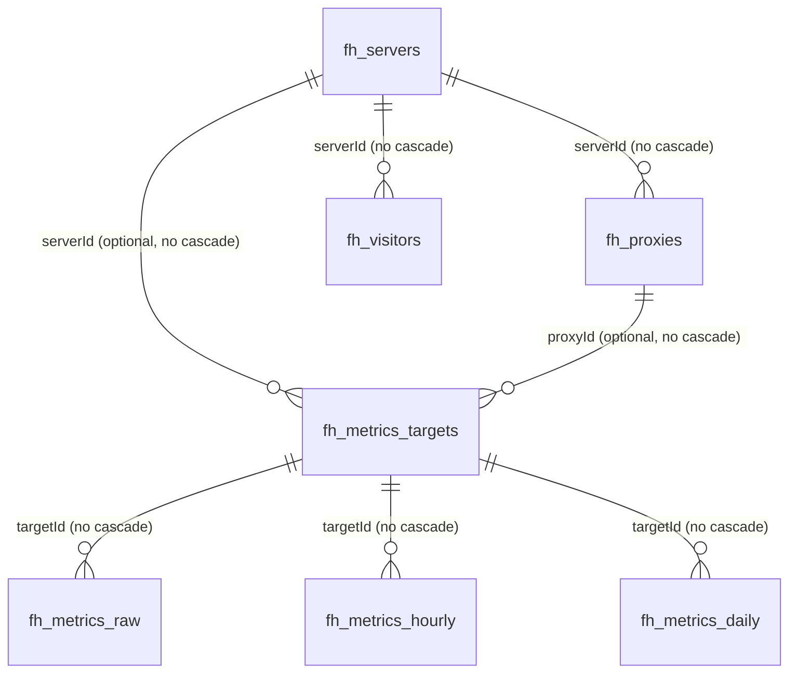

# Database Design

## Sources of Truth and Migration Constraints

PocketBase uses SQLite and registers Go migrations through the blank import of `migrations` in `main.go`; `migratecmd` enables `Automigrate: true`. `migrations/1774402980_collections_snapshot.go` imports the collection snapshot with `ImportCollectionsByMarshaledJSON(..., false)`; its rollback function is currently empty. `migrations/1793274060_enable_rate_limits.go` turns on PocketBase's built-in rate limiting (off by default) and ensures a `*:auth` rule (2 password logins per 3 seconds per client IP); existing rules are kept, and its rollback disables rate limiting. `migrations/1793360460_proxy_description.go` adds the optional `fh_proxies.description` text field; its rollback removes the field. `migrations/1793446860_stcp_visitors.go` adds stcp/sudp/xtcp to `fh_proxies.proxyType`, adds `secretKey`, `allowUsers`, and `healthCheck` to `fh_proxies`, and creates `fh_visitors`; its rollback drops the collection and fields. `migrations/1793533260_notifications.go` adds `fh_settings.notifications`; its rollback removes it. `migrations/1793619660_schema_cleanup.go` turns the port fields into integer number fields (converting stored text), drops `fh_version`, merges duplicate metrics targets and hourly/daily rows and adds unique indexes; its rollback restores text ports, `fh_version` and the old indexes (merged duplicates stay merged). `migrations/1793706060_proxy_options.go` adds the tcpmux proxy type, `fh_proxies.options`/`expiresAt`, `fh_visitors.fallbackTo`/`fallbackTimeoutMs` and `fh_servers.dashboard`; its rollback removes them. `migrations/1793792460_api_keys.go` creates `fh_api_keys`; its rollback drops it. [1793878860_proxy_probe_disabled.go](../migrations/1793878860_proxy_probe_disabled.go) adds `fh_proxies.probeDisabled` as an optional boolean defaulting to false, preserving public probes for existing records and API/import callers that omit it; rollback removes only that field. [1793965261_monitoring_state.go](../migrations/1793965261_monitoring_state.go) adds aggregation watermarks, the endpoint-change latency boundary and time-leading indexes; its down migration removes them and restores the previous raw composite index. [1794051661_server_probe_public_https.go](../migrations/1794051661_server_probe_public_https.go) adds `fh_servers.probePublicHTTPS` as an optional boolean defaulting to false, so existing servers keep probing frps's vhost ports; rollback removes only that field. Migration tests roll back with `revertThrough` in `migrations/helpers_test.go`, which keeps working as migrations are added. The migration, not any running `pb_data/data.db`, is therefore the primary schema source of truth.

Every structure/rule/index change must add a reviewable migration with an appropriate rollback. Never modify production SQLite directly or make changes only through the PocketBase Admin UI. "Default" below records only snapshot autogeneration behavior; fields without an explicit statement have no verified schema default.

The snapshot also contains PocketBase system collections such as `_mfas`, `_otps`, `_externalAuths`, `_authOrigins`, and `_superusers`, which are not individually modeled here. There are eleven application collections: `fh_users`, `fh_servers`, `fh_proxies`, `fh_visitors`, `fh_settings`, `fh_api_keys`, `fh_metrics_targets`, `fh_metrics_raw`, `fh_metrics_hourly`, `fh_metrics_daily`, and the internal aggregation watermarks `fh_metrics_state`.

Every base collection has a required system text primary key named `id`, automatically generated as 15 lowercase alphanumeric characters. Collections with `created`/`updated` use autodate fields. In the descriptions below, `—` means an empty rule, so only a superuser may perform that operation through the PocketBase Record API; this does not restrict internal server-side database/service access.

## Relationship Diagram

All relation fields use `maxSelect: 1`. The schema does not guarantee that each metrics target is bound exclusively to a server or a proxy. The schema-cleanup migration adds a unique `(serverId, proxyId)` index.

## Collection Design

### `fh_users` (auth)

Purpose: Podux login users. System fields: `password` (required, hidden, minimum 8 characters), `tokenKey` (required, hidden, 30–60 characters, automatically generated with 50 characters), `email` (required), `emailVisibility`, `verified`, `created`, and `updated`. Application fields: optional `nickname` text with max length 255; optional `avatar` file with at most one JPEG/PNG/SVG/GIF/WebP file; optional `passwordChangedAt` date.

Unique indexes: `tokenKey` and non-empty `email`. Password authentication is enabled with email as the identity; OAuth2, MFA, and OTP are disabled. The create rule is `@collection.fh_settings.initialized = false`; list/view/update/delete are restricted to `id = @request.auth.id`; the auth rule is empty, allowing authentication.

Mapping: `system.Service.InitializeSystem` creates the user; Login uses PocketBase `authWithPassword`; Settings/Profile reads and updates the user and avatar; ChangePasswordDialog updates the password.

### `fh_servers`

Purpose: remote frps connections and shared frpc configuration.

| Field | Type | Required/default | Description |
| --- | --- | --- | --- |
| `serverName` | text | Required | Display name |
| `serverAddr` | text | Required | frps address |
| `serverPort` | number | Required, integer 0–65535 | frps port |
| `description` | text | Optional | Description |
| `auth` | json | Optional | frp authentication: `method`, `token`, `additionalScopes`, and flat `oidcClientId`/`oidcClientSecret`/`oidcAudience`/`oidcScope`/`oidcTokenEndpoint`/`oidcAdditionalParams`/`oidcTrustedCa` (PEM, written to `certs/oidc-ca.pem`)/`oidcInsecureSkipVerify`, mapped to frp's `auth.oidc` at launch. Only the chosen method's fields reach frp; may contain tokens/secrets |
| `transport` | json | Optional | frp transport/TLS; may contain certificate private keys |
| `metadatas` | json | Optional | frp metadata |
| `log` | json | Optional | frp logging configuration |
| `serverVersion` | text | Required, auto `built-in` | Current frp source marker |
| `bootStatus` | text | Required, auto `stopped` | Runtime status; code uses running/stopped |
| `autoConnection` | bool | Optional | Connect automatically after startup |
| `geoLocation` | json | Optional | Populated by MonitorService; looked up right after create, cleared and looked up again when `serverAddr` changes |
| `user` | text | Optional | frp user; frps names this server's proxies `<user>.<name>-<id>` |
| `dashboard` | json | Optional | frps dashboard `url`, `user`, `password` for traffic stats and probe ports; secret |
| `probePublicHTTPS` | bool | Optional, false | Probe http/https proxies on their domain's port 443 (an HTTPS request for http) instead of frps's vhost ports, for frps behind a public HTTPS reverse proxy. Podux-only; not an frpc option and does not reload frpc |
| `created`,`updated` | autodate | Automatic | Creation/update timestamps |

Index: non-unique `bootStatus`. All list/view/create/update/delete rules require authentication. Mapping: there is no complete Go domain model; `ServerRecord` covers only ID/name. The server repository, frpc service, monitor service, and custom `/api/servers` handler read it; React Servers, ServerDetail, and ServerForm use it.

### `fh_proxies`

Purpose: frpc proxy configuration under a server.

| Field | Type | Required/default | Description |
| --- | --- | --- | --- |
| `name` | text | Required | Proxy name; the record ID is appended to the runtime name |
| `proxyType` | select | Required | One of tcp, udp, http, https, stcp, sudp, xtcp, or tcpmux |
| `serverId` | relation -> `fh_servers` | Required, N:1 | No cascading delete |
| `localIP`,`subdomain` | text | Optional | Endpoint configuration |
| `localPort`,`remotePort` | number | Optional, integer 0–65535 | 0 means not set (remotePort 0 lets frps pick); Go maps them with NullableInt |
| `description` | text | Optional, max 1000 | Free-form note edited in the proxy form; not passed to frp |
| `secretKey` | text | Optional, max 255 | stcp/sudp/xtcp key visitors must present; secret |
| `allowUsers` | json | Optional | stcp/sudp/xtcp: frp users allowed to visit (`*` = any); empty = same user only |
| `healthCheck` | json | Optional | frp `healthCheck` (`type` tcp/http, `path`, `intervalSeconds`, `timeoutSeconds`, `maxFailed`); dropped from the frp config when `type` is empty |
| `probeDisabled` | bool | Optional, false | Opt out of Podux's external reachability probe only; true cancels/skips probes and clears their cached results and alert state. Does not disable the tunnel or change frpc `healthCheck`; never exported to frpc |
| `customDomains` | json | Optional | Domain array |
| `options` | json | Optional | Extra frp proxy keys merged into the config, allowed per type (see `frpc.proxyOptionKeys`): http `httpUser`, `httpPassword`, `hostHeaderRewrite`, `locations`, `requestHeaders`, `responseHeaders`, `routeByHTTPUser`; tcpmux `httpUser`, `httpPassword`, `routeByHTTPUser`, `multiplexer` (always httpconnect); tcp/http/tcpmux `loadBalancer` (`group`, `groupKey`). Other keys are kept but not sent |
| `expiresAt` | date | Optional | A temporary proxy is disabled (and the field cleared) by a per-minute job once this passes |
| `transport`,`plugin` | json | Optional | Extended proxy configuration; `transport` uses frp's camelCase keys (`useEncryption`, `useCompression`, …). Records saved by older forms may hold `use_encryption`/`use_compression`, which frpc config generation and the edit form still read |
| `status` | select | Required | enabled/disabled |
| `bootStatus` | select | Required | online/offline |
| `created`,`updated` | autodate | Automatic | Creation/update timestamps |

Indexes: non-unique `serverId`, `proxyType`, and `status`. All CRUD/list/view rules require authentication. Mapping: `domain/proxy.Proxy`, the proxy repository/service, frpc configuration generation, and dashboard; used by React Proxies, ProxyForm, and ServerDetail. A successful update hook reloads a running server, except when only `probeDisabled` (and its `updated` timestamp) changed; see [proxy_changes.go](../internal/application/frpc/proxy_changes.go).

Bandwidth limits live in `transport` as frp's `bandwidthLimit` (e.g. `"10MB"`) and `bandwidthLimitMode` (`server`; omitted = client).

`plugin` holds frp's plugin options (`type` plus that plugin's keys). For https2http, https2https and tls2raw, `crtPath`/`keyPath` may hold PEM contents instead of paths; frpc config generation writes them atomically with owner-only permissions to `<data>/frpc/<server>/plugin-certs/<proxy-id>-<content-hash>.crt|key`; content changes force frp to rebuild that plugin, and obsolete managed generations are pruned. Paths use verified IDs, not editable names, with a confined filesystem root. The export references `certs/<proxy-id>.crt|key`; existing user-supplied file paths remain supported.

Saving an **enabled** proxy fails with a field error if another enabled proxy on the same server and of the same type uses the same `remotePort` (tcp, udp; 0 = random is not checked) or shares a `subdomain`/`customDomains` entry (http, https, tcpmux; case-insensitive). Sharing exceptions only apply to supported fields/types: a generated load-balancer group with the same `group` and `groupKey`, different `routeByHTTPUser` for http/tcpmux, or (http) no shared location. UDP does not support load-balancer sharing. See [conflicts.go](../internal/application/proxy/conflicts.go).

`RegisterConflictChecks` wraps record create/update validation and persistence in the same PocketBase nonconcurrent write transaction, reusing an existing transaction for batch/import. This protects ordinary collection API writes as well as application services. After-success work runs only after commit. Expiry scans candidate IDs, then re-reads each proxy inside a write transaction before changing only `status`/`expiresAt`; a renewed/deleted/disabled record is skipped, and concurrent metadata edits are preserved.

### `fh_visitors`

Purpose: frpc visitors that listen on the Podux host and reach an stcp/sudp/xtcp proxy through the server's frps.

| Field | Type | Required/default | Description |
| --- | --- | --- | --- |
| `name` | text | Required | Visitor name; the record ID is appended to the runtime name |
| `visitorType` | select | Required | stcp, sudp, or xtcp |
| `serverId` | relation -> `fh_servers` | Required, N:1 | No cascading delete; server delete hooks remove visitors |
| `serverName`, `serverUser` | text | `serverName` required | Target proxy name and user as registered on frps (Podux proxies are `<name>-<id>`) |
| `secretKey` | text | Optional | Must match the proxy; secret |
| `bindAddr`, `bindPort` | text, number | Optional | Local listener; empty address means 127.0.0.1, port ≤ 0 means not bound |
| `keepTunnelOpen` | bool | Optional | xtcp only |
| `fallbackTo`, `fallbackTimeoutMs` | text, number | Optional | xtcp only: ID of an enabled visitor of the same server (usually stcp, `bindPort` -1) to use when p2p fails; generated as its `<name>-<id>` |
| `transport` | json | Optional | `useEncryption`, `useCompression` |
| `status` | select | Required | enabled/disabled |
| `description` | text | Optional, max 1000 | Note |
| `created`,`updated` | autodate | Automatic | Creation/update timestamps |

Index: non-unique `serverId`. All rules require authentication (`@request.auth.id != ''`). Saving an enabled visitor fails if another enabled visitor, on any server, listens on an overlapping address and port **in the same transport namespace**: stcp/xtcp are TCP, sudp is UDP. Numeric addresses are normalized (including IPv4-mapped IPv6); wildcard IPv6 is conservatively treated as dual-stack, and validation performs no DNS requests inside the write transaction. Successful create/update/delete hooks reload the affected running server. Mapping: `domain/visitor`, `persistence.VisitorRepository`, frpc config generation/export, importer (`[[visitors]]`), React Visitors pages.

### `fh_settings`

Purpose: system initialization state and general settings. Fields are optional `initialized` bool, optional `general` JSON, and autodate `created`/`updated`; there are no application indexes. All list/view/create/update/delete rules require authentication, but the unauthenticated custom initialization API writes the fixed ID `wcstsqmz8hur331` inside a server-side transaction. Used `general` keys include `defaultLanguage`, `latencyCheckInterval`, and `locationCheckInterval`; updates merge into the stored keys. The optional `notifications` JSON holds alert settings (`enabled`, `events`, `latencyThresholdMs`, and `webhook`/`telegram`/`bark`/`email` channels); it may contain bot tokens and webhook URLs, so treat it as secret.

Mapping: `application/system.Service`, the system handler, React GeneralSettings, and the initialization flow; `notifications` maps to `application/notify`, the notify handler, and React NotificationSettings.

### `fh_api_keys`

Purpose: API keys for scripts and Prometheus. It has no relations, so it is not in the diagram.

| Field | Type | Required | Notes |
| --- | --- | --- | --- |
| `name` | text, max 100 | Yes | Label shown in the UI |
| `keyHash` | text, max 64, hidden | Yes | Hex SHA-256 of the key; the key itself is never stored |
| `prefix` | text, max 32 | No | First 12 characters of the key (`pdx_` + 8), to recognize it |
| `scope` | select `read`/`write` | Yes | `write` also allows everything `read` does |
| `lastUsedAt` | date | No | Written at most once a minute per key |
| `created`,`updated` | autodate | Automatic | Creation/update timestamps |

Index: unique `keyHash`. All rules are nil (superusers only): Podux users manage keys through `/api/api-keys`, never the collection API, and the hidden hash is not returned by it. Keys are 32 random bytes, base64url-encoded after `pdx_`; a fast hash is enough for that entropy. Mapping: `application/apikey`, `httphandler.APIKeyAuth`/`requireScope`, the API key handler, and React ApiKeySettings.

### `fh_metrics_targets`

Purpose: bind a metric series to a server or proxy. `serverId` is an optional relation to `fh_servers`; `proxyId` is an optional relation to `fh_proxies`; neither cascades on deletion. There are no `created`/`updated` fields; a unique index on `(serverId, proxyId)` prevents duplicate targets. All Record API rules are `null`. `MetricsService` currently creates only targets with a populated `serverId` and empty `proxyId`, and caches server-to-target mappings in memory. Optional date `latencySince` invalidates persisted latest-latency fallback after a server endpoint changes, including across process restarts.

### `fh_metrics_state`

[1793965261_monitoring_state.go](../migrations/1793965261_monitoring_state.go) adds this internal collection with required text `kind` (`hourly`/`daily` by convention), required date `watermark`, and a unique `kind` index. All Record API rules are nil. Each watermark is the exclusive end of completed source buckets, committed in the same transaction as its aggregate rows; a failed bucket cannot advance it. The migration also adds optional date `fh_metrics_targets.latencySince`, set when a server endpoint changes so a restarted process cannot reuse old-endpoint raw latency, plus time-leading indexes on raw/hourly/daily. Down removes the state collection/field/new indexes and restores the old raw composite index.

### `fh_metrics_raw`

Purpose: raw metric points. Required non-cascading `targetId` relation to `fh_metrics_targets`; optional `metricKey` select (currently only `frps_delay`); required `t` date; optional `val` number. The composite non-unique index is ordered `(targetId, metricKey, t)`; a separate `t` index supports aggregation and retention. There are no autodate fields, and all Record API rules are `null`. MonitorService buffers successful samples and flushes at 64 samples or one second in a single-writer transaction; failures are latest-status cache entries, not raw rows. Latest-status reads use memory first and query history only for missing entries, bounded to the last 10 minutes and the target's `latencySince`; warmed reads do not scan history. Retention removes data older than 7 days only after rollups catch up.

### `fh_metrics_hourly`

Purpose: hourly aggregates. Optional relation `targetId`, optional select `metricKey`, optional date `t`, and optional numbers `valAvg`/`valMax`/`valMin`. It has a unique `(targetId, metricKey, t)` index, no autodate fields, and `null` for all Record API rules. At startup and minute 5 of every hour, completed UTC buckets after the persisted watermark are caught up using `INSERT ... SELECT ... ON CONFLICT` in one transaction per bucket, not a read/save per aggregate row. An indexed earliest-time query skips empty periods. When initializing watermarks on an older installation, existing rows in the oldest potentially partly retained source bucket are preserved. Data older than 30 days is deleted only after daily rollups catch up, in batches of at most 2000 rows.

### `fh_metrics_daily`

Purpose: daily aggregates. Fields match hourly, and all three value fields are optional numbers. It has a unique `(targetId, metricKey, t)` index, no autodate fields, and `null` for all Record API rules. Startup/hourly recovery fills all completed UTC days since the persisted daily watermark (average of `valAvg`, max of `valMax`, min of `valMin`), after hourly recovery succeeds. This preserves the existing average-of-hourly-averages semantics, not a sample-count-weighted daily mean. At 01:05 the retention job first catches up both rollups and then deletes daily rows older than one calendar year. It never materializes the current partial day.

## Lifecycle, Deletion, and Sensitivity

- The frpc lifecycle service resets server/proxy runtime statuses at startup and is their sole runtime writer. Collection request hooks reject client ownership of `bootStatus`, and partial updates preserve newer status writes. Status is a transient runtime projection; configuration itself is persistent.
- Aggregation follows raw -> hourly -> daily. Retention targets are 7 days raw, 30 days hourly and one year daily; cleanup must not pass an unprocessed aggregation watermark.
- Every relation uses `cascadeDelete: false`. Deleting an `fh_servers` record is handled by hooks in [cleanup.go](../internal/application/server/cleanup.go): in one transaction it deletes the server's proxies and visitors (as records, so their hooks fire), its metrics targets and their raw/hourly/daily rows, then the server; after the commit its frpc is stopped and cached metrics are dropped. Deleting a single proxy still leaves its proxy-level metrics targets, if any.
- PocketBase protects `fh_users.password/tokenKey`; `fh_servers.auth/transport/dashboard` may contain tokens, OIDC secrets, dashboard passwords and TLS private keys; `fh_proxies.options`/`plugin` may hold HTTP passwords and private keys; `fh_proxies.secretKey`, `fh_visitors.secretKey`, and `fh_settings.notifications` hold secrets too. The frpc.toml export redacts secrets unless asked to include them. Configuration logs no longer serialize whole credentials-bearing configurations. Shared structural redaction also covers case-insensitive sensitive keys, URL userinfo and key material; disabled TLS does not retain a private-key leak in a default export. Original values must never be committed or echoed.
- Migration workflow: identify callers -> add forward/down migrations -> update models/repositories/services/UI -> update this document -> verify upgrade and rollback against a temporary database -> run the full checks. Never rewrite the snapshot to falsify existing deployment history.

## Current Discrepancies / To Be Confirmed

- The snapshot migration has an empty down function and cannot automatically restore the pre-import schema; rollback strategy remains technical debt.
- Backups (`/api/system/backups`) exclude PocketBase's backups/temp/cache directories. Restoring replaces application data, including users, so sessions may need to sign in again. A small `backups/.podux-restore.json` journal survives replacement; it is not a collection and needs no schema migration. It stores only the latest task's random status capability/timestamps/state/fixed error code, with 0600 permissions and a 24-hour query lifetime. See the [restore contract](architecture.md#backup-restore-contract).
