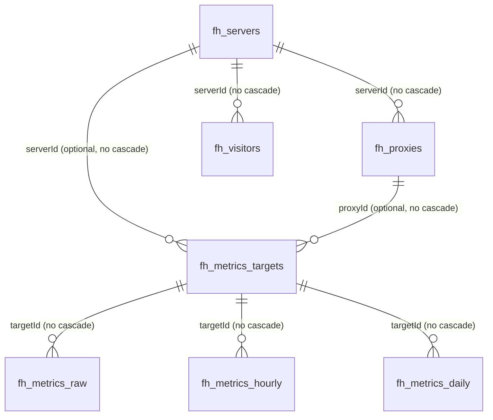

# Database Design

## Sources of Truth and Migration Constraints

PocketBase uses SQLite and registers Go migrations through the blank import of `migrations` in `main.go`; `migratecmd` enables `Automigrate: true`. `migrations/1774402980_collections_snapshot.go` imports the collection snapshot with `ImportCollectionsByMarshaledJSON(..., false)`; its rollback function is currently empty. `migrations/1793274060_enable_rate_limits.go` turns on PocketBase's built-in rate limiting (off by default) and ensures a `*:auth` rule (2 password logins per 3 seconds per client IP); existing rules are kept, and its rollback disables rate limiting. `migrations/1793360460_proxy_description.go` adds the optional `fh_proxies.description` text field; its rollback removes the field. `migrations/1793446860_stcp_visitors.go` adds stcp/sudp/xtcp to `fh_proxies.proxyType`, adds `secretKey`, `allowUsers`, and `healthCheck` to `fh_proxies`, and creates `fh_visitors`; its rollback drops the collection and fields. `migrations/1793533260_notifications.go` adds `fh_settings.notifications`; its rollback removes it. `migrations/1793619660_schema_cleanup.go` turns the port fields into integer number fields (converting stored text), drops `fh_version`, merges duplicate metrics targets and hourly/daily rows and adds unique indexes; its rollback restores text ports, `fh_version` and the old indexes (merged duplicates stay merged). `migrations/1793706060_proxy_options.go` adds the tcpmux proxy type, `fh_proxies.options`/`expiresAt`, `fh_visitors.fallbackTo`/`fallbackTimeoutMs` and `fh_servers.dashboard`; its rollback removes them. Migration tests roll back with `revertThrough` in `migrations/helpers_test.go`, which keeps working as migrations are added. The migration, not any running `pb_data/data.db`, is therefore the primary schema source of truth.

Every structure/rule/index change must add a reviewable migration with an appropriate rollback. Never modify production SQLite directly or make changes only through the PocketBase Admin UI. "Default" below records only snapshot autogeneration behavior; fields without an explicit statement have no verified schema default.

The snapshot also contains PocketBase system collections such as `_mfas`, `_otps`, `_externalAuths`, `_authOrigins`, and `_superusers`, which are not individually modeled here. There are nine application collections: `fh_users`, `fh_servers`, `fh_proxies`, `fh_visitors`, `fh_settings`, `fh_metrics_targets`, `fh_metrics_raw`, `fh_metrics_hourly`, and `fh_metrics_daily`.

Every base collection has a required system text primary key named `id`, automatically generated as 15 lowercase alphanumeric characters. Collections with `created`/`updated` use autodate fields. In the descriptions below, `—` means an empty rule, so only a superuser may perform that operation through the PocketBase Record API; this does not restrict internal server-side database/service access.

## Relationship Diagram

All relation fields use `maxSelect: 1`. The schema neither guarantees that each metrics target is bound exclusively to a server or a proxy nor defines a unique `(serverId, proxyId)` index.

## Collection Design

### `fh_users` (auth)

Purpose: Podux login users. System fields: `password` (required, hidden, minimum 8 characters), `tokenKey` (required, hidden, 30–60 characters, automatically generated with 50 characters), `email` (required), `emailVisibility`, `verified`, `created`, and `updated`. Application fields: optional `nickname` text with max length 255; optional `avatar` file with at most one JPEG/PNG/SVG/GIF/WebP file; optional `passwordChangedAt` date.

Unique indexes: `tokenKey` and non-empty `email`. Password authentication is enabled with email as the identity; OAuth2, MFA, and OTP are disabled. The create rule is `@collection.fh_settings.initialized = false`; list/view/update/delete are restricted to `id = @request.auth.id`; the auth rule is empty, allowing authentication.

Mapping: `system.Service.InitializeSystem` creates the user; Login uses PocketBase `authWithPassword`; Settings/Profile reads and updates the user and avatar; ChangePasswordDialog updates the password.

### `fh_servers`

Purpose: remote frps connections and shared frpc configuration.

| Field | Type | Required/default | Description |
| --- | --- | --- | --- |
| `serverName` | text | Required | Display name |
| `serverAddr` | text | Required | frps address |
| `serverPort` | number | Required, integer 0–65535 | frps port |
| `description` | text | Optional | Description |
| `auth` | json | Optional | frp authentication (`method`, `token`, flat `oidcClientId`/`oidcClientSecret`/`oidcAudience`/`oidcTokenEndpoint`, mapped to frp's `auth.oidc` at launch); may contain tokens/secrets |
| `transport` | json | Optional | frp transport/TLS; may contain certificate private keys |
| `metadatas` | json | Optional | frp metadata |
| `log` | json | Optional | frp logging configuration |
| `serverVersion` | text | Required, auto `built-in` | Current frp source marker |
| `bootStatus` | text | Required, auto `stopped` | Runtime status; code uses running/stopped |
| `autoConnection` | bool | Optional | Connect automatically after startup |
| `geoLocation` | json | Optional | Populated by MonitorService; looked up right after create, cleared and looked up again when `serverAddr` changes |
| `user` | text | Optional | frp user; frps names this server's proxies `<user>.<name>-<id>` |
| `dashboard` | json | Optional | frps dashboard `url`, `user`, `password` for traffic stats and probe ports; secret |
| `created`,`updated` | autodate | Automatic | Creation/update timestamps |

Index: non-unique `bootStatus`. All list/view/create/update/delete rules require authentication. Mapping: there is no complete Go domain model; `ServerRecord` covers only ID/name. The server repository, frpc service, monitor service, and custom `/api/servers` handler read it; React Servers, ServerDetail, and ServerForm use it.

### `fh_proxies`

Purpose: frpc proxy configuration under a server.

| Field | Type | Required/default | Description |
| --- | --- | --- | --- |
| `name` | text | Required | Proxy name; the record ID is appended to the runtime name |
| `proxyType` | select | Required | One of tcp, udp, http, https, stcp, sudp, xtcp, or tcpmux |
| `serverId` | relation -> `fh_servers` | Required, N:1 | No cascading delete |
| `localIP`,`subdomain` | text | Optional | Endpoint configuration |
| `localPort`,`remotePort` | number | Optional, integer 0–65535 | 0 means not set (remotePort 0 lets frps pick); Go maps them with NullableInt |
| `description` | text | Optional, max 1000 | Free-form note edited in the proxy form; not passed to frp |
| `secretKey` | text | Optional, max 255 | stcp/sudp/xtcp key visitors must present; secret |
| `allowUsers` | json | Optional | stcp/sudp/xtcp: frp users allowed to visit (`*` = any); empty = same user only |
| `healthCheck` | json | Optional | frp `healthCheck` (`type` tcp/http, `path`, `intervalSeconds`, `timeoutSeconds`, `maxFailed`); dropped from the frp config when `type` is empty |
| `customDomains` | json | Optional | Domain array |
| `options` | json | Optional | Extra frp proxy keys merged into the config, allowed per type (see `frpc.proxyOptionKeys`): http `httpUser`, `httpPassword`, `hostHeaderRewrite`, `locations`, `requestHeaders`, `responseHeaders`, `routeByHTTPUser`; tcpmux `httpUser`, `httpPassword`, `routeByHTTPUser`, `multiplexer` (always httpconnect); tcp/http/tcpmux `loadBalancer` (`group`, `groupKey`). Other keys are kept but not sent |
| `expiresAt` | date | Optional | A temporary proxy is disabled (and the field cleared) by a per-minute job once this passes |
| `transport`,`plugin` | json | Optional | Extended proxy configuration; `transport` uses frp's camelCase keys (`useEncryption`, `useCompression`, …). Records saved by older forms may hold `use_encryption`/`use_compression`, which frpc config generation and the edit form still read |
| `status` | select | Required | enabled/disabled |
| `bootStatus` | select | Required | online/offline |
| `created`,`updated` | autodate | Automatic | Creation/update timestamps |

Indexes: non-unique `serverId`, `proxyType`, and `status`. All CRUD/list/view rules require authentication. Mapping: `domain/proxy.Proxy`, the proxy repository/service, frpc configuration generation, and dashboard; used by React Proxies, ProxyForm, and ServerDetail. A successful update hook reloads a running server.

Bandwidth limits live in `transport` as frp's `bandwidthLimit` (e.g. `"10MB"`) and `bandwidthLimitMode` (`server`; omitted = client).

`plugin` holds frp's plugin options (`type` plus that plugin's keys). For https2http, https2https and tls2raw, `crtPath`/`keyPath` may hold PEM contents instead of paths; frpc config generation writes them to `<data>/frpc/<server>/plugin-certs/` and the export references `certs/<name>.crt|key`.

Saving an **enabled** proxy fails with a field error if another enabled proxy on the same server and of the same type uses the same `remotePort` (tcp, udp; 0 = random is not checked) or shares a `subdomain`/`customDomains` entry (http, https, tcpmux; case-insensitive). Exceptions, as frps allows them: both in the same load balancing group (same `group` and `groupKey`), different `routeByHTTPUser`, or (http) no shared location. See [conflicts.go](../internal/application/proxy/conflicts.go).

### `fh_visitors`

Purpose: frpc visitors that listen on the Podux host and reach an stcp/sudp/xtcp proxy through the server's frps.

| Field | Type | Required/default | Description |
| --- | --- | --- | --- |
| `name` | text | Required | Visitor name; the record ID is appended to the runtime name |
| `visitorType` | select | Required | stcp, sudp, or xtcp |
| `serverId` | relation -> `fh_servers` | Required, N:1 | No cascading delete; server delete hooks remove visitors |
| `serverName`, `serverUser` | text | `serverName` required | Target proxy name and user as registered on frps (Podux proxies are `<name>-<id>`) |
| `secretKey` | text | Optional | Must match the proxy; secret |
| `bindAddr`, `bindPort` | text, number | Optional | Local listener; empty address means 127.0.0.1, port ≤ 0 means not bound |
| `keepTunnelOpen` | bool | Optional | xtcp only |
| `fallbackTo`, `fallbackTimeoutMs` | text, number | Optional | xtcp only: ID of an enabled visitor of the same server (usually stcp, `bindPort` -1) to use when p2p fails; generated as its `<name>-<id>` |
| `transport` | json | Optional | `useEncryption`, `useCompression` |
| `status` | select | Required | enabled/disabled |
| `description` | text | Optional, max 1000 | Note |
| `created`,`updated` | autodate | Automatic | Creation/update timestamps |

Index: non-unique `serverId`. All rules require authentication (`@request.auth.id != ''`). Saving an enabled visitor fails if another enabled visitor, on any server, listens on the same port with the same address or either address is 0.0.0.0. Successful create/update/delete hooks reload the affected running server. Mapping: `domain/visitor`, `persistence.VisitorRepository`, frpc config generation/export, importer (`[[visitors]]`), React Visitors pages.

### `fh_settings`

Purpose: system initialization state and general settings. Fields are optional `initialized` bool, optional `general` JSON, and autodate `created`/`updated`; there are no application indexes. All list/view/create/update/delete rules require authentication, but the unauthenticated custom initialization API writes the fixed ID `wcstsqmz8hur331` inside a server-side transaction. Used `general` keys include `defaultLanguage`, `latencyCheckInterval`, and `locationCheckInterval`; updates merge into the stored keys. The optional `notifications` JSON holds alert settings (`enabled`, `events`, `latencyThresholdMs`, and `webhook`/`telegram`/`bark`/`email` channels); it may contain bot tokens and webhook URLs, so treat it as secret.

Mapping: `application/system.Service`, the system handler, React GeneralSettings, and the initialization flow; `notifications` maps to `application/notify`, the notify handler, and React NotificationSettings.

### `fh_metrics_targets`

Purpose: bind a metric series to a server or proxy. `serverId` is an optional relation to `fh_servers`; `proxyId` is an optional relation to `fh_proxies`; neither cascades on deletion. There are no `created`/`updated` fields; a unique index on `(serverId, proxyId)` prevents duplicate targets. All Record API rules are `null`. `MetricsService` currently creates only targets with a populated `serverId` and empty `proxyId`, and caches server-to-target mappings in memory.

### `fh_metrics_raw`

Purpose: raw metric points. Required non-cascading `targetId` relation to `fh_metrics_targets`; optional `metricKey` select (currently only `frps_delay`); required `t` date; optional `val` number. The composite non-unique index is ordered `(targetId, t, metricKey)`. There are no autodate fields, and all Record API rules are `null`. MonitorService writes non-negative latency for reachable servers (failed probes are kept only in memory as the latest status); the 01:05 daily job deletes data older than 7 days. The latest-status lookup scans only the last 10 minutes and groups by `targetId`, so it uses the `(targetId, t, metricKey)` index instead of a per-row subquery.

### `fh_metrics_hourly`

Purpose: hourly aggregates. Optional relation `targetId`, optional select `metricKey`, optional date `t`, and optional numbers `valAvg`/`valMax`/`valMin`. It has a unique `(targetId, metricKey, t)` index, no autodate fields, and `null` for all Record API rules. At minute 5 of every hour, the previous complete hour is aggregated and then updated or inserted after lookup by target/key/time; the unique index rejects a racing duplicate. Data older than 30 days is deleted daily.

### `fh_metrics_daily`

Purpose: daily aggregates. Fields match hourly, and all three value fields are optional numbers. It has a unique `(targetId, metricKey, t)` index, no autodate fields, and `null` for all Record API rules. At 01:05 daily, the previous day's hourly values are aggregated (average of `valAvg`, max of `valMax`, min of `valMin`) and upserted. The same job deletes daily rows older than one year.

## Lifecycle, Deletion, and Sensitivity

- Server/proxy runtime statuses are reset at startup. Status is a transient runtime projection; configuration itself is persistent.
- Aggregation follows raw -> hourly -> daily. Raw data is retained for 7 days and hourly data for 30 days; no verified limit exists for daily data.
- Every relation uses `cascadeDelete: false`. Deleting an `fh_servers` record is handled by hooks in [cleanup.go](../internal/application/server/cleanup.go): in one transaction it deletes the server's proxies and visitors (as records, so their hooks fire), its metrics targets and their raw/hourly/daily rows, then the server; after the commit its frpc is stopped and cached metrics are dropped. Deleting a single proxy still leaves its proxy-level metrics targets, if any.
- PocketBase protects `fh_users.password/tokenKey`; `fh_servers.auth/transport/dashboard` may contain tokens, OIDC secrets, dashboard passwords and TLS private keys; `fh_proxies.options`/`plugin` may hold HTTP passwords and private keys; `fh_proxies.secretKey`, `fh_visitors.secretKey`, and `fh_settings.notifications` hold secrets too. The frpc.toml export redacts secrets unless asked to include them. Logs mask common JSON key names, but original values must still never be exported, committed, or echoed.
- Migration workflow: identify callers -> add forward/down migrations -> update models/repositories/services/UI -> update this document -> verify upgrade and rollback against a temporary database -> run the full checks. Never rewrite the snapshot to falsify existing deployment history.

## Current Discrepancies / To Be Confirmed

- The snapshot migration has an empty down function and cannot automatically restore the pre-import schema; rollback strategy remains technical debt.
- Backups (`/api/system/backups`) zip the whole data directory except `backups/`; restoring one replaces all data, including users, so every session must sign in again.
